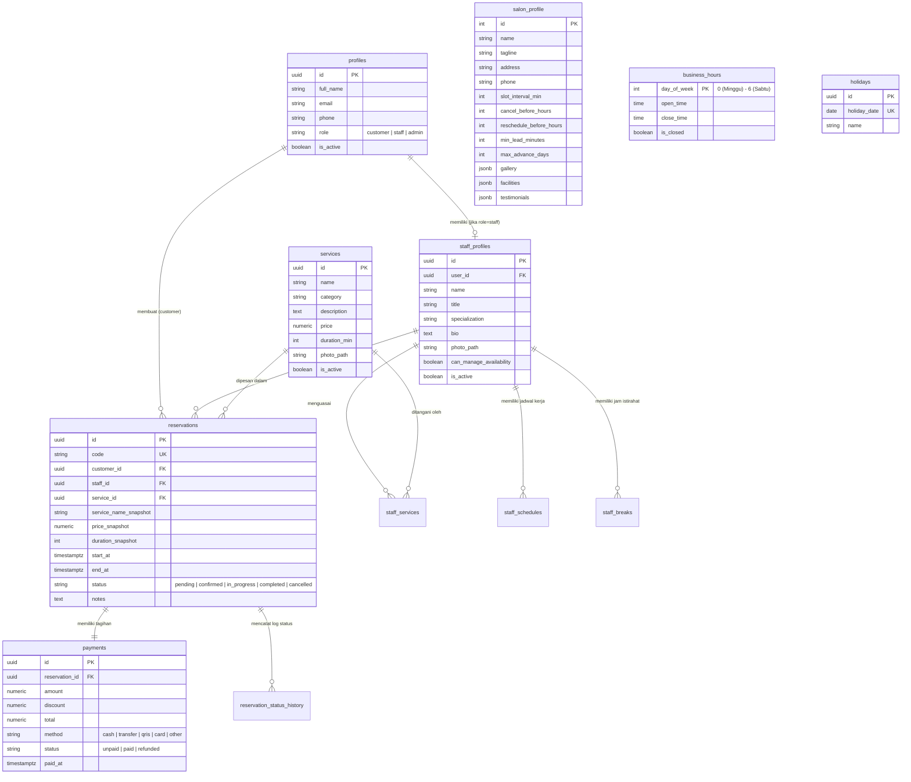

# ✨ BeautyCare — Sistem Informasi Reservasi Salon & Klinik Kecantikan

BeautyCare adalah aplikasi web *full-stack* untuk manajemen operasional dan reservasi layanan salon serta klinik kecantikan secara daring (*online*). Aplikasi ini dirancang untuk memudahkan pelanggan memesan jadwal perawatan tanpa antre, membantu terapis memantau agenda kerja harian, serta memfasilitasi admin dalam mengelola layanan, staf, jam operasional, dan rekapitulasi transaksi dengan pencegahan jadwal bentrok (*anti double-booking*).

---

## 📋 Daftar Isi
1. [Ringkasan Produk (Mini-PRD)](#1-ringkasan-produk-mini-prd)
2. [Arsitektur & Teknologi](#2-arsitektur--teknologi)
3. [Fitur Utama Berdasarkan Hak Akses (Role)](#3-fitur-utama-berdasarkan-hak-akses-role)
4. [Desain Database & ERD](#4-desain-database--erd)
5. [Implementasi Validasi 3 Lapis & Integritas Data](#5-implementasi-validasi-3-lapis--integritas-data)
6. [Prasyarat & Petunjuk Instalasi](#6-prasyarat--petunjuk-instalasi)
7. [Konfigurasi Environment (.env.example)](#7-konfigurasi-environment-envexample)
8. [Inisialisasi Database, Seeding & Pengujian](#8-inisialisasi-database-seeding--pengujian)
9. [Konfigurasi Web Push & Background Worker](#9-konfigurasi-web-push--background-worker)

---

## 1. Ringkasan Produk (Mini-PRD)

### Latar Belakang Masalah
Proses pemesanan layanan salon secara manual (melalui telepon/chat) sering menyebabkan pencatatan jadwal yang tumpang tindih (*double-booking*), ketidakpastian ketersediaan terapis, serta kesulitan dalam merekap riwayat transaksi dan perubahan harga layanan.

### Solusi & Tujuan
Membangun sistem informasi reservasi terpusat berbasis web yang:
1. Menghitung ketersediaan slot waktu secara *real-time* berdasarkan durasi layanan, jam buka salon, hari libur, jadwal kerja terapis, waktu istirahat (*break*), dan reservasi aktif lainnya.
2. Menjamin tidak adanya jadwal terapis yang bentrok menggunakan transaksi database dan *exclusion constraint* di level PostgreSQL.
3. Menyimpan *snapshot* nama layanan, durasi, dan harga saat reservasi dibuat agar perubahan harga di masa depan tidak merusak riwayat laporan keuangan.

---

## 2. Arsitektur & Teknologi

### Tech Stack Utama
- **Framework Full-Stack:** Next.js 14 (App Router), React 18, JavaScript (ES6+)
- **Styling & UI:** Tailwind CSS, Lucide React Icons, Recharts (Visualisasi Grafik Dashboard)
- **Database & Autentikasi:** PostgreSQL & Supabase Auth (`@supabase/ssr`, `@supabase/supabase-js`)
- **Object Storage:** Supabase Storage (Bucket `assets` untuk foto layanan, staf, dan galeri salon)
- **Validasi Skema:** Zod (`zod`)
- **Deployment:** Vercel

### Struktur Direktori
```text
web_beautycare-main/
├── src/
│   ├── api/
│   │   └── client.js             # Klien pengakses data, pemetaan error PostgreSQL & RPC
│   ├── app/                      # Next.js App Router (Halaman & API Route Handlers)
│   │   ├── (public)/             # Halaman publik (Beranda, Profil, Layanan, Terapis, Login, Daftar)
│   │   ├── pelanggan/            # Area khusus Pelanggan (Reservasi, Aktif, Kalender, Riwayat, Profil)
│   │   ├── staff/                # Area khusus Staf/Terapis (Jadwal Pelayanan, Ketersediaan, Profil)
│   │   ├── admin/                # Panel Admin (Dashboard, Reservasi, Layanan, Staf, Jam, Transaksi)
│   │   └── api/admin/staff/      # Backend Route Handlers untuk manajemen akun & jadwal staf
│   ├── components/               # Komponen UI reusable (Layouts, Modal, SlotChecker, ImageUpload, dll)
│   ├── context/                  # React Context (AuthContext & ToastContext)
│   ├── lib/                      # Utilitas (Zod schemas, format tanggal/Rupiah WIB, Supabase client/server)
│   ├── views/                    # Komponen tampilan utama per halaman/fitur
│   └── middleware.js             # Server-side route protection untuk halaman terproteksi
├── scripts/                      # Skrip inisialisasi seed data & pengujian konkurensi (double-booking)
├── package.json
└── tailwind.config.js
```

---

## 3. Fitur Utama Berdasarkan Hak Akses (Role)

| Role | Fitur & Hak Akses |
| :--- | :--- |
| **Publik (Tanpa Login)** | • Melihat halaman *landing*, profil salon, fasilitas, galeri, testimoni, dan jam operasional.<br>• Mencari & memfilter katalog layanan berdasarkan nama atau kategori.<br>• Melihat daftar terapis beserta spesialisasi dan layanan yang dikuasai.<br>• Mengecek slot waktu yang tersedia (*live slot checker*) sebelum login. |
| **Pelanggan (`customer`)** | • Registrasi akun pelanggan & login.<br>• Membuat reservasi baru (memilih layanan, preferensi terapis/otomatis, tanggal, slot jam, dan catatan).<br>• Memantau status layanan secara *visual tracker* (`Menunggu` → `Dikonfirmasi` → `Berlangsung` → `Selesai`).<br>• Mengubah jadwal (*reschedule*) dan membatalkan reservasi sesuai batas waktu aturan salon.<br>• Melihat kalender jadwal aktif, riwayat reservasi, serta mengelola profil/email/password. |
| **Staf / Terapis (`staff`)** | • Melihat ringkasan jumlah pelayanan hari ini dan minggu ini.<br>• Melihat daftar agenda pelayanan harian beserta detail catatan pelanggan.<br>• Memperbarui status tahapan layanan (`Konfirmasi` → `Mulai Layanan` → `Selesaikan`).<br>• Mengelola jam istirahat pribadi (*break time*) jika diberi izin oleh Admin. |
| **Admin (`admin`)** | • **Dashboard Analitik:** Kartu statistik, grafik batang reservasi (14 hari / 6 bulan), layanan terpopuler, dan jadwal hari ini.<br>• **Manajemen Reservasi:** Cari, filter multi-kriteria, konfirmasi, batalkan, ubah jadwal/terapis, dan lihat *audit log* riwayat status.<br>• **Manajemen Layanan:** CRUD layanan, unggah foto ke *object storage*, dan *soft-deactivation* jika layanan sudah pernah dipesan.<br>• **Manajemen Staf:** Buat akun staf, atur spesialisasi layanan, jadwal kerja mingguan, dan jam istirahat.<br>• **Jam Operasional & Aturan:** Atur jam buka per hari, interval slot, batas waktu *cancel/reschedule*, dan daftar hari libur.<br>• **Rekap Transaksi:** Catat pembayaran manual (Tunai, QRIS, Transfer, Kartu), diskon, status lunas/*refund*, dan **Ekspor CSV**. |

---

## 4. Desain Database & ERD

Database menggunakan PostgreSQL dengan skema relasional berikut:



### Fungsi RPC & Constraint Penting di PostgreSQL
- `get_available_slots(p_service, p_staff, p_date, p_exclude)`: Menghitung slot jam yang tersedia secara akurat di sisi database.
- `create_reservation(...)` & `reschedule_reservation(...)`: Menjalankan pembuatan dan perubahan jadwal dalam transaksi atomik.
- `change_status(p_id, p_to, p_note)`: Memvalidasi transisi status reservasi dan otomatis mencatat riwayat ke `reservation_status_history`.
- **Exclusion Constraint (`23P01`):** Mencegah seorang staf memiliki dua reservasi aktif pada rentang waktu (`tstzrange(start_at, end_at)`) yang beririsan.

---

## 5. Implementasi Validasi 3 Lapis & Integritas Data

1. **Lapisan 1 — Frontend (React Client Validation):**
   - Validasi format email, nomor telepon Indonesia (`^(\+62|62|0)8\d{7,12}$`), kekuatan password (minimal 8 karakter, kombinasi huruf & angka), rentang durasi layanan (5–480 menit), serta validasi jam selesai > jam mulai.
   - Pencegahan *double-submit* dengan menonaktifkan tombol (`loading={busy}`) saat proses pengiriman berlangsung.
2. **Lapisan 2 — Backend & Server Guard (Next.js & Zod):**
   - Pengecekan sesi autentikasi di `src/middleware.js` dan otorisasi berbasis role di Server Layouts (`/admin`, `/staff`, `/pelanggan`) serta `requireAdmin()` pada Route Handlers.
   - Validasi skema *payload* menggunakan **Zod** (`src/lib/schemas.js`) yang mengembalikan HTTP `422 Unprocessable Entity` beserta detail field yang salah.
   - Mekanisme *manual rollback* pada pembuatan akun staf jika salah satu tahap penyimpanan relasi gagal.
3. **Lapisan 3 — Database (PostgreSQL Constraints & RLS):**
   - Penggunaan *Row-Level Security* (RLS), `PRIMARY KEY`, `FOREIGN KEY`, `UNIQUE` (kode reservasi, tanggal libur), `CHECK` constraint, serta `EXCLUDE USING gist` untuk mencegah *race condition* jadwal bentrok (mengembalikan kode error `23P01` yang diterjemahkan menjadi HTTP `409 Conflict`).

---

## 6. Prasyarat & Petunjuk Instalasi

### Prasyarat Sistem
- **Node.js** versi `18.17.0` atau lebih baru (disarankan v20 LTS).
- **npm** atau package manager setara.
- Proyek **Supabase** (PostgreSQL + Auth + Storage bucket bernama `assets` dengan akses *Public* untuk pembacaan gambar).

### Langkah Menjalankan Aplikasi Secara Lokal

1. **Clone repository ini:**
   ```bash
   git clone <URL_REPO_GITHUB_KALIAN>
   cd web_beautycare-main
   ```

2. **Instal seluruh dependensi:**
   ```bash
   npm install
   ```

3. **Salin dan konfigurasi file environment:**
   Buat file `.env.local` di direktori utama mengacu pada bagian [Konfigurasi Environment](#7-konfigurasi-environment-envexample) di bawah.

4. **Jalankan server pengembangan (Development):**
   ```bash
   npm run dev
   ```
   Buka `http://localhost:3000` di browser.

5. **Build untuk produksi (Production):**
   ```bash
   npm run build
   npm start
   ```

---

## 7. Konfigurasi Environment (`.env.example`)

Buat file bernama `.env.local` (jangan pernah meng-commit secret asli ke Git) dengan format berikut:

```env
# Konfigurasi Supabase (Wajib)
NEXT_PUBLIC_SUPABASE_URL=https://your-project-id.supabase.co
NEXT_PUBLIC_SUPABASE_ANON_KEY=your-supabase-anon-public-key
SUPABASE_SERVICE_ROLE_KEY=your-supabase-service-role-secret-key

# Konfigurasi Web Push VAPID & Redis Worker (Untuk modul notifikasi)
NEXT_PUBLIC_VAPID_PUBLIC_KEY=your-vapid-public-key
VAPID_PRIVATE_KEY=your-vapid-private-key
VAPID_SUBJECT=mailto:admin@beautycare.id
REDIS_URL=redis://localhost:6379
```

---

## 8. Inisialisasi Database, Seeding & Pengujian

1. **Migrasi Skema Database:**
   Jalankan file SQL migrasi pada SQL Editor Supabase untuk membuat tabel, fungsi RPC (`get_available_slots`, `create_reservation`, `change_status`, `reschedule_reservation`), kebijakan RLS, dan bucket storage `assets`.

2. **Menjalankan Seed Data Awal:**
   Untuk mengisi profil salon, jam operasional, minimal 5 layanan, akun staf, akun pelanggan, dan data reservasi awal:
   ```bash
   npm run seed
   ```

3. **Pengujian Pencegahan Jadwal Bentrok (Race Condition / Double-Booking):**
   Untuk memverifikasi bahwa dua permintaan reservasi pada terapis dan jam yang sama tidak akan pernah lolos bersamaan:
   ```bash
   npm run test:booking
   ```

---

## 9. Konfigurasi Web Push & Background Worker

> **Catatan Arsitektur:** Sesuai standar teknis *full-stack*, pengiriman notifikasi perubahan status reservasi dirancang berjalan secara *asynchronous* di luar siklus transaksi utama agar kegagalan pengiriman notifikasi tidak membatalkan penyimpanan reservasi.

1. **Generate VAPID Keys:**
   ```bash
   npx web-push generate-vapid-keys
   ```
   Masukkan *Public Key* dan *Private Key* ke dalam `.env.local`.
2. **Menjalankan Redis & Background Worker:**
   Pastikan *instance* Redis aktif, lalu jalankan proses worker secara terpisah untuk memproses antrean notifikasi reservasi.
